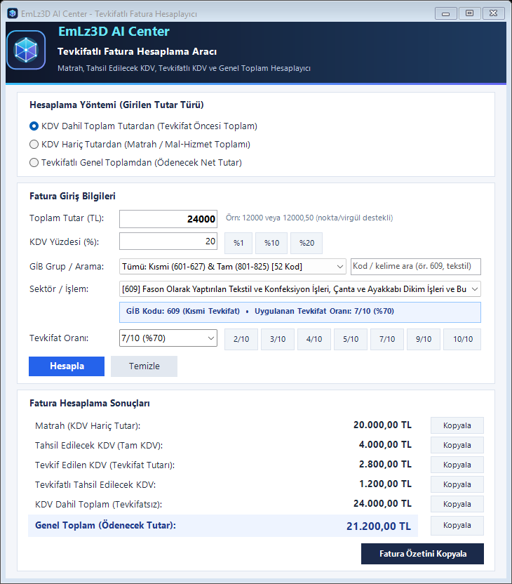
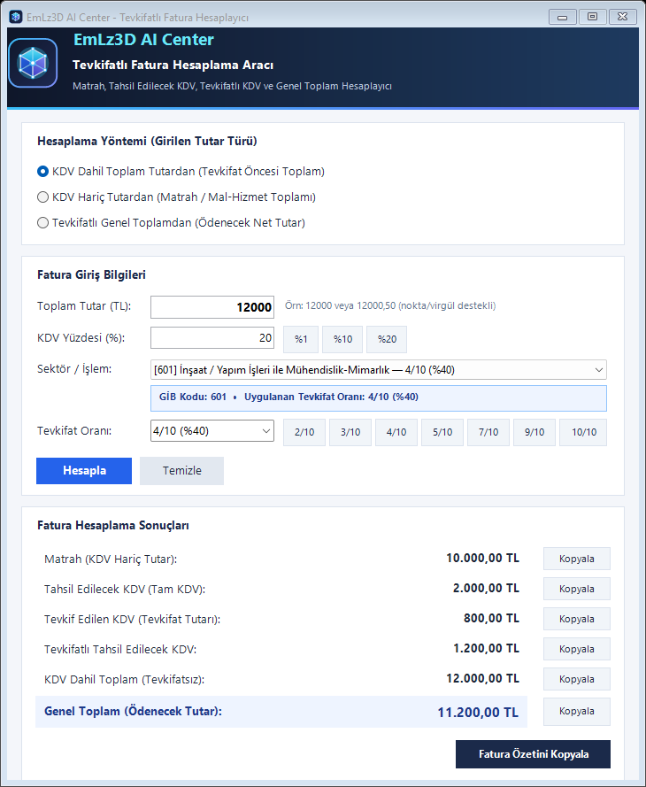
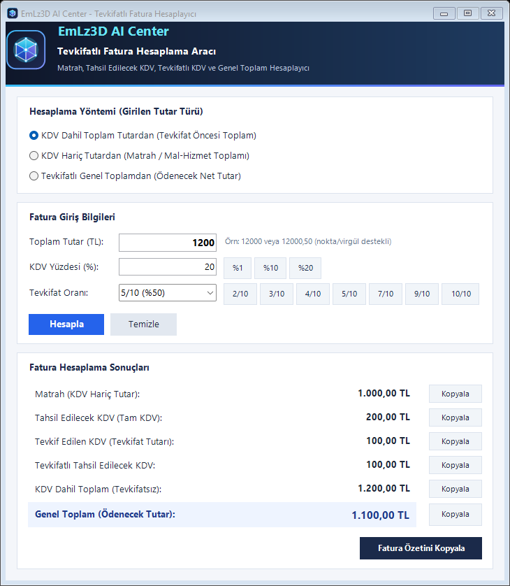
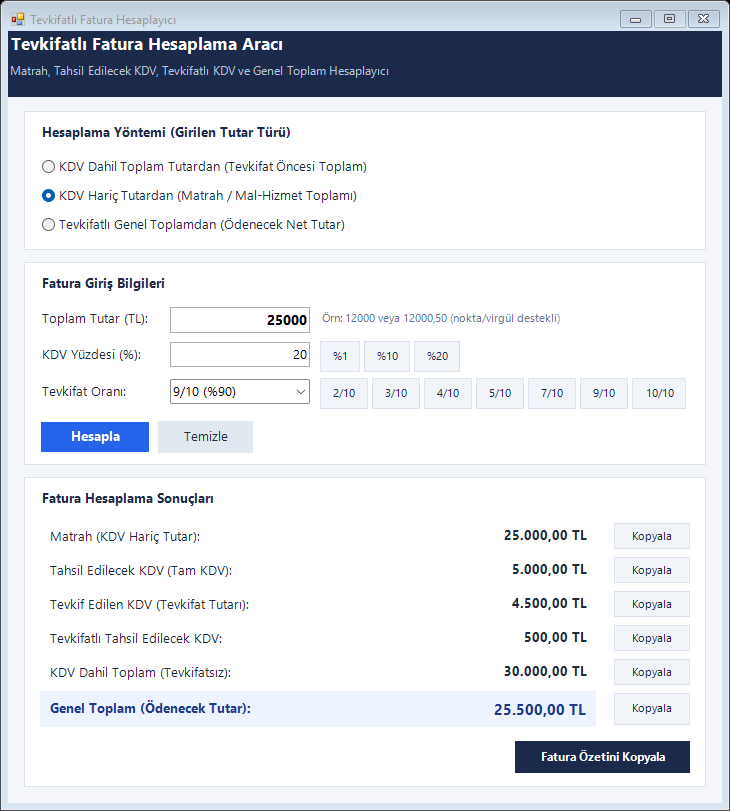
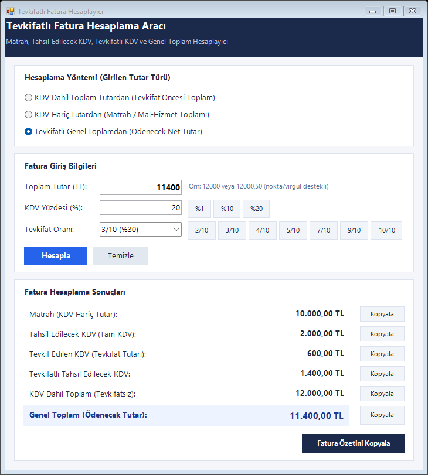

<div align="center">

# EmLz3D AI Center — Tevkifatlı Fatura & Matrah Hesaplama Aracı

**Türkiye GİB UBL-TR güncel 52 tevkifat kodunu destekleyen, tek dosyalık (`.exe`) kurulumsuz Windows masaüstü hesaplama aracı.**


-10B981?style=for-the-badge)


<br />



</div>

---

## Öne Çıkan Özellikler

- **Üç Farklı Tutar Giriş Modu:**
  1. **KDV Dahil Toplam Tutardan** *(Tevkifat Öncesi Toplam)*
  2. **KDV Hariç Tutardan** *(Matrah / Mal-Hizmet Toplamı)*
  3. **Tevkifatlı Genel Toplamdan** *(Ödenecek Net Tutar)*
- **Güncel GİB UBL-TR Tam Tevkifat Kataloğu (52 Resmi Kod):**
  - `601`–`627` arası **27 Kısmi Tevkifat** kodu *(Hizmet İşlemleri & Mal Teslimleri)*
  - `801`–`825` arası **25 Tam Tevkifat (`10/10`)** kodu *(İsteğe Bağlı / Kamu İdareleri)*
- **Kategori Filtresi ve Türkçe Duyarlı Anlık Arama:** Kod (`609`, `825`) veya kelime (`tekstil`, `inşaat`, `hurda`, `güvenlik`) yazarak ilgili GİB kodunu anında bulur ve seçer.
- **Akıllı Çift Yönlü Senkronizasyon:** Sektör seçildiğinde tevkifat oranı otomatik uygulanır ve GİB kodu bilgi rozetinde vurgulanır; oran manuel olarak değiştirildiğinde sektör seçimi otomatik olarak `Manuel / Özel Oran Seçimi` moduna geçer.
- **Esnek Sayı Formatı & Canlı Hesaplama:** Ondalık ayracı olarak hem virgül (`,`) hem nokta (`.`) destekler (`12000,50`, `12000.50`, `12.000,50`); yazdıkça anlık sonuç üretir.
- **e-Arşiv / e-Fatura Uyumlu Tek Tıkla Kopyalama:** Her sonuç satırının yanında `1000,00` biçiminde panoya kopyalama butonu ve tüm fatura dökümünü tek seferde aktaran **Fatura Özetini Kopyala** butonu bulunur.
- **Sıfır Kurulum ve Harici Bağımlılık Yok:** Doğrudan Windows içinde yerleşik `.NET Framework 4.x` ile çalışır; harici DLL veya runtime kurulumu gerektirmez.

---

## Ekran Görüntüleri

<table>
  <tr>
    <td align="center" width="50%">
      <strong>GİB 52 Kod Tam Liste & Anlık Arama</strong><br />
      <sub>[609] Tekstil / Konfeksiyon Fason — 7/10 (%70)</sub><br /><br />
      
    </td>
    <td align="center" width="50%">
      <strong>Sektöre Göre Otomatik GİB Kodu Rozeti</strong><br />
      <sub>[601] Yapım İşleri — 4/10 (%40)</sub><br /><br />
      
    </td>
  </tr>
  <tr>
    <td align="center" width="50%">
      <strong>EmLz3D AI Center Sabit Başlık & Vektörel Logo</strong><br />
      <sub>KDV Dahil Toplamdan Hesaplama (1.200 TL • 5/10)</sub><br /><br />
      
    </td>
    <td align="center" width="50%">
      <strong>KDV Hariç Tutardan (Matrahtan) Hesaplama</strong><br />
      <sub>25.000 TL Matrah • %20 KDV • 9/10 Tevkifat</sub><br /><br />
      
    </td>
  </tr>
  <tr>
    <td align="center" colspan="2">
      <strong>Tevkifatlı Genel Toplamdan (Ödenecek Net Tutardan) Ters Hesaplama</strong><br />
      <sub>11.400 TL Genel Toplam • %20 KDV • 3/10 Tevkifat → 10.000 TL Matrah</sub><br /><br />
      
    </td>
  </tr>
</table>

---

## Hesaplama Formülleri

Burada $k = \frac{\text{KDV Yüzdesi}}{100}$ ve $t = \text{Tevkifat Oranı}$ (örneğin $\frac{4}{10} = 0{,}40$) olarak tanımlanır:

| Giriş Yöntemi | Matrah Formülü |
| :--- | :--- |
| **KDV Dahil Toplam Tutardan** | $\text{Matrah} = \frac{\text{Tutar}}{1 + k}$ |
| **KDV Hariç Tutardan (Matrah)** | $\text{Matrah} = \text{Tutar}$ |
| **Tevkifatlı Genel Toplamdan** | $\text{Matrah} = \frac{\text{Tutar}}{1 + k \cdot (1 - t)}$ |

Devamındaki tüm fatura kalemleri kuruş hassasiyeti (`MidpointRounding.AwayFromZero`) ve e-Fatura iç tutarlılığı korunarak hesaplanır:

- **Tahsil Edilecek KDV (Tam KDV):** $\text{KDV}_{\text{tam}} = \text{Matrah} \times k$
- **Tevkif Edilen KDV (Tevkifat Tutarı):** $\text{KDV}_{\text{tevkif}} = \text{KDV}_{\text{tam}} \times t$
- **Tevkifatlı Tahsil Edilecek KDV:** $\text{KDV}_{\text{tahsil}} = \text{KDV}_{\text{tam}} - \text{KDV}_{\text{tevkif}}$
- **KDV Dahil Toplam (Tevkifatsız):** $\text{Matrah} + \text{KDV}_{\text{tam}}$
- **Genel Toplam (Ödenecek Tutar):** $\text{Matrah} + \text{KDV}_{\text{tahsil}}$

### Örnek Hesaplama (`[601]` Yapım İşleri • `12.000 TL` KDV Dahil • `%20` KDV • `4/10` Tevkifat)

| Fatura Kalemi | Tutar |
| :--- | ---: |
| **Matrah (KDV Hariç Tutar)** | `10.000,00 TL` |
| **Tahsil Edilecek KDV (Tam KDV)** | `2.000,00 TL` |
| **Tevkif Edilen KDV (4/10 Tevkifat)** | `800,00 TL` |
| **Tevkifatlı Tahsil Edilecek KDV (6/10)** | `1.200,00 TL` |
| **KDV Dahil Toplam (Tevkifatsız)** | `12.000,00 TL` |
| **Genel Toplam (Ödenecek Tutar)** | **`11.200,00 TL`** |

---

## Desteklenen GİB Güncel Tevkifat Kodları (`601`–`627` ve `801`–`825`)

### Kısmi Tevkifat Kodları (`601`–`627`)

| GİB Kodu | İşlem / Hizmet / Teslim Türü | Kategori | Oran |
| :---: | :--- | :--- | :---: |
| **601** | Yapım İşleri ile Bu İşlerle Birlikte İfa Edilen Mühendislik-Mimarlık ve Etüt-Proje Hizmetleri | Hizmet | **4/10** |
| **602** | Etüt, Plan-Proje, Danışmanlık, Denetim ve Benzeri Hizmetler | Hizmet | **9/10** |
| **603** | Makine, Teçhizat, Demirbaş ve Taşıtlara Ait Tadil, Bakım ve Onarım Hizmetleri | Hizmet | **7/10** |
| **604** | Yemek Servis Hizmeti | Hizmet | **5/10** |
| **605** | Organizasyon Hizmeti | Hizmet | **5/10** |
| **606** | İşgücü Temin Hizmetleri | Hizmet | **9/10** |
| **607** | Özel Güvenlik Hizmeti | Hizmet | **9/10** |
| **608** | Yapı Denetim Hizmetleri | Hizmet | **9/10** |
| **609** | Fason Olarak Yaptırılan Tekstil ve Konfeksiyon İşleri, Çanta ve Ayakkabı Dikim İşleri ve Aracılık Hizmetleri | Hizmet | **7/10** |
| **610** | Turistik Mağazalara Verilen Müşteri Bulma / Götürme Hizmetleri | Hizmet | **9/10** |
| **611** | Spor Kulüplerinin Yayın, Reklâm ve İsim Hakkı Gelirlerine Konu İşlemleri | Hizmet | **9/10** |
| **612** | Temizlik Hizmeti | Hizmet | **9/10** |
| **613** | Çevre ve Bahçe Bakım Hizmetleri | Hizmet | **9/10** |
| **614** | Servis Taşımacılığı Hizmeti | Hizmet | **5/10** |
| **615** | Her Türlü Baskı ve Basım Hizmetleri | Hizmet | **7/10** |
| **616** | 5018 Sayılı Kanuna Ekli Cetvellerdeki İdare, Kurum ve Kuruluşlara Yapılan Diğer Hizmetler | Hizmet | **5/10** |
| **617** | Hurda Metalden Elde Edilen Külçe Teslimleri | Mal Teslimi | **7/10** |
| **618** | Hurda Metalden Elde Edilenler Dışındaki Bakır, Çinko, Demir-Çelik, Alüminyum ve Kurşun Külçe Teslimi | Mal Teslimi | **7/10** |
| **619** | Bakır, Çinko, Alüminyum ve Kurşun Ürünlerinin Teslimi | Mal Teslimi | **7/10** |
| **620** | İstisnadan Vazgeçenlerin Hurda ve Atık Teslimi | Mal Teslimi | **7/10** |
| **621** | Metal, Plastik, Lastik, Kauçuk, Kâğıt ve Cam Hurda ve Atıklardan Elde Edilen Hammadde Teslimi | Mal Teslimi | **9/10** |
| **622** | Pamuk, Tiftik, Yün ve Yapağı İle Ham Post ve Deri Teslimleri | Mal Teslimi | **9/10** |
| **623** | Ağaç ve Orman Ürünleri Teslimi | Mal Teslimi | **5/10** |
| **624** | Yük Taşımacılığı Hizmeti | Hizmet | **2/10** |
| **625** | Ticari Reklam Hizmetleri | Hizmet | **3/10** |
| **626** | Diğer Teslimler | Mal Teslimi | **2/10** |
| **627** | Demir-Çelik Ürünlerinin Teslimi | Mal Teslimi | **5/10** |

<details>
<summary><strong>Tam Tevkifat / İsteğe Bağlı Tam Tevkifat Kodları — 801–825 (25 Kod, 10/10 — %100)</strong></summary>

<br />

| GİB Kodu | İşlem / Hizmet / Teslim Türü | Oran |
| :---: | :--- | :---: |
| **801** | Yapım İşleri ile Bu İşlerle Birlikte İfa Edilen Mühendislik-Mimarlık ve Etüt-Proje Hizmetleri (Tam Tevkifat) | **10/10** |
| **802** | Etüt, Plan-Proje, Danışmanlık, Denetim ve Benzeri Hizmetler (Tam Tevkifat) | **10/10** |
| **803** | Makine, Teçhizat, Demirbaş ve Taşıtlara Ait Tadil, Bakım ve Onarım Hizmetleri (Tam Tevkifat) | **10/10** |
| **804** | Yemek Servis Hizmeti (Tam Tevkifat) | **10/10** |
| **805** | Organizasyon Hizmeti (Tam Tevkifat) | **10/10** |
| **806** | İşgücü Temin Hizmetleri (Tam Tevkifat) | **10/10** |
| **807** | Özel Güvenlik Hizmeti (Tam Tevkifat) | **10/10** |
| **808** | Yapı Denetim Hizmetleri (Tam Tevkifat) | **10/10** |
| **809** | Fason Olarak Yaptırılan Tekstil ve Konfeksiyon İşleri, Çanta ve Ayakkabı Dikim İşleri (Tam Tevkifat) | **10/10** |
| **810** | Turistik Mağazalara Verilen Müşteri Bulma / Götürme Hizmetleri (Tam Tevkifat) | **10/10** |
| **811** | Spor Kulüplerinin Yayın, Reklâm ve İsim Hakkı Gelirlerine Konu İşlemleri (Tam Tevkifat) | **10/10** |
| **812** | Temizlik Hizmeti (Tam Tevkifat) | **10/10** |
| **813** | Çevre ve Bahçe Bakım Hizmetleri (Tam Tevkifat) | **10/10** |
| **814** | Servis Taşımacılığı Hizmeti (Tam Tevkifat) | **10/10** |
| **815** | Her Türlü Baskı ve Basım Hizmetleri (Tam Tevkifat) | **10/10** |
| **816** | Hurda Metalden Elde Edilen Külçe Teslimleri (Tam Tevkifat) | **10/10** |
| **817** | Hurda Metalden Elde Edilenler Dışındaki Bakır, Çinko, Demir-Çelik, Alüminyum ve Kurşun Külçe Teslimi (Tam Tevkifat) | **10/10** |
| **818** | Bakır, Çinko, Alüminyum ve Kurşun Ürünlerinin Teslimi (Tam Tevkifat) | **10/10** |
| **819** | İstisnadan Vazgeçenlerin Hurda ve Atık Teslimi (Tam Tevkifat) | **10/10** |
| **820** | Metal, Plastik, Lastik, Kauçuk, Kâğıt ve Cam Hurda ve Atıklardan Elde Edilen Hammadde Teslimi (Tam Tevkifat) | **10/10** |
| **821** | Pamuk, Tiftik, Yün ve Yapağı İle Ham Post ve Deri Teslimleri (Tam Tevkifat) | **10/10** |
| **822** | Ağaç ve Orman Ürünleri Teslimi (Tam Tevkifat) | **10/10** |
| **823** | Yük Taşımacılığı Hizmeti (Tam Tevkifat) | **10/10** |
| **824** | Ticari Reklam Hizmetleri (Tam Tevkifat) | **10/10** |
| **825** | Demir-Çelik Ürünlerinin Teslimi (Tam Tevkifat) | **10/10** |

</details>

---

## Kullanım ve Kaynak Koddan Derleme

### Hazır Uygulamayı Çalıştırma
Depo içerisindeki [`TevkifatHesaplayici.exe`](TevkifatHesaplayici.exe) dosyasını indirip çift tıklayarak doğrudan çalıştırabilirsiniz.

### Kaynak Koddan Derleme
Herhangi bir ek SDK veya Visual Studio kurulumu olmadan, Windows'ta yerleşik `.NET Framework 4.x` C# derleyicisi (`csc.exe`) ile [`build.bat`](build.bat) dosyasını çalıştırarak derleyebilirsiniz:

```bat
build.bat
```

Veya PowerShell üzerinden doğrudan:

```powershell
& "C:\Windows\Microsoft.NET\Framework64\v4.0.30319\csc.exe" /target:winexe /out:TevkifatHesaplayici.exe /codepage:65001 /utf8output /r:System.dll,System.Drawing.dll,System.Windows.Forms.dll Program.cs
```

---

<div align="center">
  <sub><strong>EmLz3D AI Center</strong> tarafından geliştirilmiştir.</sub>
</div>
